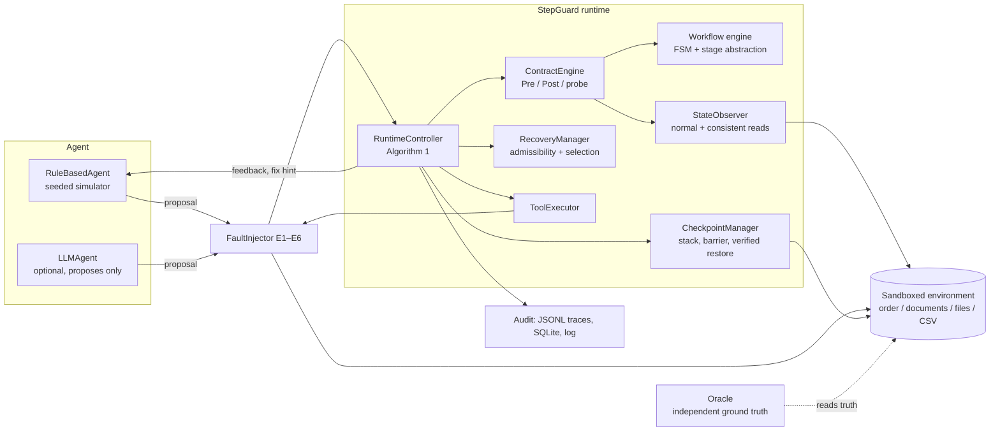

# StepGuard architecture

StepGuard sits between an agent and its tools. The agent proposes one structured action at a time; StepGuard
decides whether it may run, runs it, checks what actually happened to the environment's state, and picks a
recovery when the check fails. It never lets the agent call a tool directly.

## Components (backend/core)

| Module | Responsibility |
|---|---|
| `models.py` | Pydantic models for specifications (workflow, tool contract, conditions, fault targets) and runtime records (step record, checkpoint event, run result); enums for verdicts, probe results, strategies, faults and configurations. |
| `expressions.py` | Allowlisted expression evaluator. YAML conditions are parsed with `ast` and only a fixed set of node types and functions is accepted (comparisons, boolean logic, arithmetic, subscripts, read-only attribute access, `len/min/max/sum/get/values/pluck/sha256/...`). No calls to arbitrary functions, no dunder access, no comprehensions, no `eval`. An undefined value raises `ExpressionError`, which the engines turn into **INCONCLUSIVE**, never into ACCEPT. |
| `workflow_engine.py` | Loads and validates YAML workflows (graph checks, every expression compiled, every tool implemented by the environment, every fault type targeted), computes the transition function, enabled actions, stage abstraction α(s), invariants and completion. Records a SHA-256 of each file. |
| `action_registry.py` | Registry of environments and of named Python predicates that YAML may reference by name (e.g. `cart_matches_request`). |
| `contract_engine.py` | Pre-condition check in a fixed order (known tool → role → duplicate key → transition → dependencies → argument schema → observability → preconditions); post-condition check (observability → output schema → effect → expected stage → invariants); effect probe returning APPLIED / ABSENT / UNKNOWN. |
| `state_observer.py` | Reads the environment. Ordinary reads can be stale with probability `read_lag` (read-after-write lag); probes and restoration checks use a consistent read. Unobservable state returns `None`. |
| `tool_executor.py` | Executes one tool call through the fault injector and normalises errors and timeouts. |
| `checkpoint_manager.py` | Checkpoint stack, irreversible barrier *b*, feasibility test, rollback with compensation sized from the observed effect, and restoration verification (stage, invariants, snapshot equality). |
| `recovery_manager.py` | Admissibility rules for RETRY / RESUME / ROLLBACK / REPAIR / ESCALATE and the selective (failure-class) or unselective policy. |
| `fault_injector.py` | Seeded, configuration-independent injection of E1–E6. |
| `runtime_controller.py` | The verification loop; configurations SG_FULL and the four ablations are flags on this controller. |
| `audit_logger.py` | Rotating log, secret redaction, JSONL trace writer. |

## Environments (backend/environments)

All four run locally. File-based ones work inside a fresh temporary directory per episode (`.sandbox/`) that is
deleted afterwards; nothing outside it is ever written. The order service is in memory and makes no payments.
Each environment exposes `observe()` (what StepGuard may see), `truth()` (unrestricted state, for the oracle only),
`snapshot()/restore()` (restorable state only) and an append-only `ledger` of side effects that actually landed.

## Experiments (backend/experiments)

`scenarios.py` builds tasks deterministically from (workflow, template, seed); `runner.py` runs every scenario under
every configuration; `baselines.py` implements A and B; `oracle.py` labels unsafe actions, goal completion and
duplicate side effects from ground truth; `metrics.py` and `statistics.py` compute the measures; `report.py`
renders the Markdown report from the stored summary.

## Persistence

SQLite (`stepguard.db`, schema in `backend/database/schema.sql`): workflows, experiments, scenarios, episodes,
step_events (one row per verification decision), injected_faults, checkpoint_events, recovery_decisions,
metric_summaries, simulations. Each experiment also writes `results/<id>/traces.jsonl`, `episodes.csv`,
`summary.json` and `config.json`.

## Interfaces

* FastAPI (`backend/main.py`, `backend/api/`) with interactive docs at `/docs`.
* Streamlit dashboard (`frontend/`), which uses the API when it is running and otherwise calls the same Python
  functions in-process.
* Command-line scripts in `scripts/` and the `run.py` launcher.
